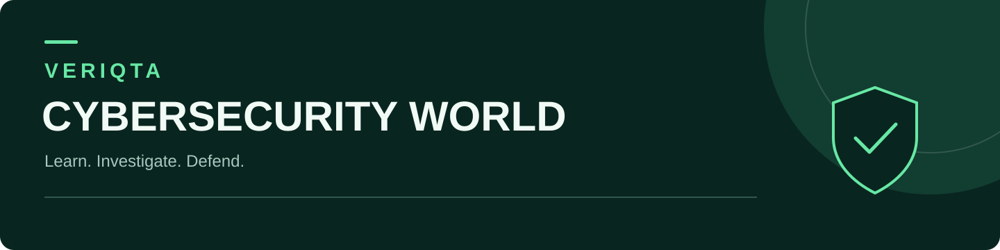

# VERIQTA CYBERSECURITY WORLD

Cybersecurity learning publications, organised into ten subject groups.

## Subject groups

- [Cybersecurity Foundations](01-CYBERSECURITY-FOUNDATIONS/)
- [Digital Forensics](02-DIGITAL-FORENSICS/)
- [Incident Response and DFIR](03-INCIDENT-RESPONSE-AND-DFIR/)
- [Security Operations Center](04-SECURITY-OPERATIONS-CENTER/)
- [Threat Intelligence](05-THREAT-INTELLIGENCE/)
- Detection Engineering and Threat Hunting
- [Governance, Risk and Compliance](07-GOVERNANCE-RISK-AND-COMPLIANCE/)
- IT Audit and Security Assurance
- [Cloud and Infrastructure Security](09-CLOUD-AND-INFRASTRUCTURE-SECURITY/)
- [Specialized Defensive Security and Career](10-SPECIALIZED-DEFENSIVE-SECURITY-AND-CAREER/)

Only groups with available publications have folders.

Use these materials for learning and practise only in authorised environments.

## Licence

See [LICENSE](LICENSE) for the terms of use.
